 

 

<a href="#-how-i-solve-problems"><kbd> 01 · Method </kbd></a>
<a href="#-challenge-my-solver"><kbd> 02 · Play </kbd></a>
<a href="#-problems-ive-worked-on"><kbd> 03 · Work </kbd></a>
<a href="#-toolbox"><kbd> 04 · Toolbox </kbd></a>
<a href="#-live-activity"><kbd> 05 · Live </kbd></a>
<a href="#-got-a-problem-worth-solving"><kbd> 06 · Contact </kbd></a>

### I find the real problem first, then build the system that solves it.

Final-year CSE (AI & Data Science) student from Bhubaneswar. I start from a concrete pain — a failed payment, a credit-invisible business, an inventory risk nobody caught — and ship the whole solution: data model, backend, AI layer, interface, and the guardrails that make it safe to trust.

- 🧩 **Problem first.** Every project below starts from a specific, costly problem, not from a tech stack.
- 🛡️ **AI with guardrails.** I pair models with deterministic rules, policy checks, and audit trails, so the output can be verified.
- 🏗️ **End to end.** Python, TypeScript, Go, and Rust — from PostgreSQL schema to deployed product.
- 📊 **Data-driven roots.** Started with ML models and dashboards; that habit of measuring before deciding stuck.
- 🤝 **Open to** internships, hackathon teams, and hard problems worth solving.

<b>Recruiter with 30 seconds?</b>

 

- Final-year B.Tech CSE (AI & Data Science), Bhubaneswar — open to internships and new-grad roles.
- Ships complete products across Python, TypeScript, Go, and Rust, not just notebooks.
- Best three to open: [Decision Kernel](https://github.com/Sarthak702-droid/DECISION-KERNEL) (Rust), [OpsPilot Lite](https://github.com/Sarthak702-droid/OpsPilot-Lite) (Next.js + Go), [RecoverOS](https://github.com/Sarthak702-droid/Recovery-Os) (Python).
- Fastest way to reach me: [LinkedIn](https://www.linkedin.com/in/sarthaktripathy91104) or [email](mailto:sarthaktripathy2004@gmail.com).

<b>Engineer who wants to see how this page works?</b>

 

- Every graphic here is an SVG generated or hand-written in [this repo](https://github.com/Sarthak702-droid/Sarthak702-droid) — no third-party stats services.
- [`scripts/update_profile.py`](scripts/update_profile.py) (standard library only) queries the GitHub GraphQL API, then draws the odometer tiles, the isometric contribution skyline, and the maze.
- The maze is a depth-first maze seeded by a word, solved with A\* and a Manhattan heuristic; the animation replays the exact order the search expanded cells.
- A [GitHub Action](.github/workflows/profile.yml) reruns it daily, and whenever someone opens a `maze:` issue.

<b>Founder or teammate with a messy problem?</b>

 

- I like problems where the hard part is deciding what to build: payments that fail, credit that can't be scored, risk nobody is watching.
- I'll ask who hurts and what "fixed" means before I touch a keyboard.
- Tell me about it: [email](mailto:sarthaktripathy2004@gmail.com).

---

## 🧠 How I solve problems

  

---

## 🎮 Challenge my solver

Give me any word. It becomes the seed for a brand-new maze, my A\* solver cracks it, and this page updates with the replay — usually in under a minute.

  

<!--MAZE:START-->
**Now solving:** `daily-2026-11-14` — today's daily maze · A\* explored **211** of 300 cells · shortest path **48** steps
<!--MAZE:END-->

  

  or one click:
  <a href="https://github.com/Sarthak702-droid/Sarthak702-droid/issues/new?body=Change%20the%20word%20after%20%22maze%3A%22%20in%20the%20title%20if%20you%20like%2C%20then%20press%20Create.%20A%20bot%20builds%20and%20solves%20your%20maze%20and%20replies%20here.&title=maze%3A%20dragon"><kbd>dragon</kbd></a>
  <a href="https://github.com/Sarthak702-droid/Sarthak702-droid/issues/new?body=Change%20the%20word%20after%20%22maze%3A%22%20in%20the%20title%20if%20you%20like%2C%20then%20press%20Create.%20A%20bot%20builds%20and%20solves%20your%20maze%20and%20replies%20here.&title=maze%3A%20entropy"><kbd>entropy</kbd></a>
  <a href="https://github.com/Sarthak702-droid/Sarthak702-droid/issues/new?body=Change%20the%20word%20after%20%22maze%3A%22%20in%20the%20title%20if%20you%20like%2C%20then%20press%20Create.%20A%20bot%20builds%20and%20solves%20your%20maze%20and%20replies%20here.&title=maze%3A%20bhubaneswar"><kbd>bhubaneswar</kbd></a>
  <a href="https://github.com/Sarthak702-droid/Sarthak702-droid/issues/new?body=Change%20the%20word%20after%20%22maze%3A%22%20in%20the%20title%20if%20you%20like%2C%20then%20press%20Create.%20A%20bot%20builds%20and%20solves%20your%20maze%20and%20replies%20here.&title=maze%3A%2042"><kbd>42</kbd></a>
  <a href="https://github.com/Sarthak702-droid/Sarthak702-droid/issues/new?body=Change%20the%20word%20after%20%22maze%3A%22%20in%20the%20title%20if%20you%20like%2C%20then%20press%20Create.%20A%20bot%20builds%20and%20solves%20your%20maze%20and%20replies%20here.&title=maze%3A%20hire-sarthak"><kbd>hire-sarthak</kbd></a>

---

## 🚀 Problems I've worked on

<table>
<tr>
<td width="50%" valign="top">

### [Decision Kernel](https://github.com/Sarthak702-droid/DECISION-KERNEL)

**Problem** — Automated decisions that lean on AI are hard to reproduce and hard to audit.

**Solution** — A high-performance, headless decision runtime that combines deterministic rules, evidence verification, and bounded external semantic judgments — and never executes business actions itself.

`Rust` `DAG` `Deterministic` `Decision engine`

</td>
<td width="50%" valign="top">

### [OpsPilot Lite](https://github.com/Sarthak702-droid/OpsPilot-Lite)

**Problem** — Small businesses spot inventory and supply-chain risk only after it has cost them money.

**Solution** — An operations-intelligence and risk-governance engine for SMBs: deterministic risk scoring, maker-checker approvals, and a copilot grounded in the business's own data.

`Next.js` `Go` `PostgreSQL` `Redis`

</td>
</tr>
<tr>
<td width="50%" valign="top">

### [RecoverOS](https://github.com/Sarthak702-droid/Recovery-Os)

**Problem** — Failed payments leak revenue, and blind retries make it worse.

**Solution** — A revenue-recovery platform that detects and analyses failed payments, recommends the safest recovery action, and validates every AI decision through a policy engine before execution. Outcomes are verified by Razorpay webhooks.

`Python` `TypeScript` `Razorpay` `Policy engine`

</td>
<td width="50%" valign="top">

### [Kredo](https://github.com/Sarthak702-droid/kredo)

**Problem** — Credit-invisible MSMEs get rejected because lenders can't see how healthy they really are.

**Solution** — A credit-intelligence platform that builds a Financial Health Card from GST, UPI, Account Aggregator, EPFO, and bank data, so banks and fintechs can assess creditworthiness with more signal and less risk.

`TypeScript` `Fintech` `Credit scoring`

</td>
</tr>
<tr>
<td width="50%" valign="top">

### [ICCAP](https://github.com/Sarthak702-droid/ICCAPIntelligentConversationalAIandCrimeAnalyticsPlatform)

**Problem** — Police data is sensitive: investigators need search and analytics, but every access must be scoped and provable.

**Solution** — A zero-trust conversational AI and crime-analytics platform with role-scoped case search, graph analytics, field redaction, rate limiting, and a tamper-evident audit log built on cryptographic hash chaining.

`Go` `TypeScript` `Open Policy Agent` `Zero trust`

</td>
<td width="50%" valign="top">

### [VibeGuard](https://github.com/Sarthak702-droid/VibeGuard)

**Problem** — AI coding tools ship risky edits fast, and developers can't review all of them.

**Solution** — An open-source CLI that scans a project, builds clean context, packs the relevant files, verifies changes, explains diffs, and flags risky AI edits before they land.

`Python` `Rust` `CLI` `Developer tools`

</td>
</tr>
</table>

<b>More builds</b> — healthcare, maritime, education, and live deployments

 

| Project | Problem it tackles | Stack |
|---|---|---|
| [ArogyaGrid](https://github.com/Sarthak702-droid/Swasthya) | Predicts healthcare resource shortages before they happen and redistributes resources to where they are needed most | `TypeScript` `Go` `PostgreSQL` |
| [Nautrace](https://github.com/Sarthak702-droid/Nautrace) | Maritime domain intelligence | `Python` `Go` `TypeScript` |
| [VORQ](https://github.com/Sarthak702-droid/VORQ) | Role-aware construction operations and financial control for Indian residential contractors | `TypeScript` `Python` |
| [Veyra](https://github.com/Sarthak702-droid/Veyra-SamrtAttendance) | Smarter online classrooms: attendance automation, gesture interaction, and learning analytics | `TypeScript` |
| [Cognilib](https://github.com/Sarthak702-droid/Cognilib) · [live](https://cognilib.vercel.app) | A smart, role-based digital library system | `TypeScript` |
| [InnoGrid](https://github.com/Sarthak702-droid/InnoGrid-Website) · [live](https://innogrid.vercel.app) | Website for the InnoGrid community | `HTML` |

<b>Machine-learning notebooks</b> — where it started

 

| Project | What it does |
|---|---|
| [Brain Tumor Detection](https://github.com/Sarthak702-droid/Brain-Tumor-Detection) | Medical-image classification |
| [Alzheimer Detection System](https://github.com/Sarthak702-droid/Alzimer-Detection-System) | Medical-image classification |
| [Video Sentiment Analysis](https://github.com/Sarthak702-droid/video-sentiment-analysis) | Sentiment from video data |
| [Stock Time-Series Analysis](https://github.com/Sarthak702-droid/Stock-Time---Series-Analysis) | Time-series exploration and modelling |
| [Car Price Prediction](https://github.com/Sarthak702-droid/Car-Price-Predection-using-Linear-Regression) | Linear regression with an interactive Gradio app |
| [Spam Email Classifier](https://github.com/Sarthak702-droid/spam-email-classifier) | Text classification |

---

## 💻 Toolbox

  

<b>Show it as a list</b>

 

**Languages**

**AI & Data**

**Product & Infrastructure**

---

## 📈 Live activity

  

**Recently shipped** — rebuilt every day by a [GitHub Action](.github/workflows/profile.yml), straight from the GitHub API.

<!--RECENT:START-->
| Repository | What it is | Stack | Last push |
|---|---|---|---|
| [**VORQ**](https://github.com/Sarthak702-droid/VORQ) | Role-Aware Construction Operations & Financial-Control Platform for Indian Residential Contractors | `TypeScript` | 06 Nov 2026 |
| [**MedOCR**](https://github.com/Sarthak702-droid/MedOCR) | A gemini Based OCR platform | — | 12 Oct 2026 |
| [**OpsPilot-Lite**](https://github.com/Sarthak702-droid/OpsPilot-Lite) | Autonomous Operations Intelligence & Deterministic Risk Governance Engine for SMBs with Grounded Copilot AI | `TypeScript` | 25 Sep 2026 |
| [**Swasthya**](https://github.com/Sarthak702-droid/Swasthya) | ArogyaGrid predicts healthcare resource shortages before they happen and intelligently redistributes available… | `TypeScript` | 08 Sep 2026 |
| [**Nautrace**](https://github.com/Sarthak702-droid/Nautrace) | Nautrace — Maritime Domain Intelligence | `Python` | 05 Sep 2026 |
<!--RECENT:END-->

---

## 📫 Got a problem worth solving?

I like problems that are messy, real, and a little uncomfortable. If you have one — or a team that needs someone who finishes things — reach out.

  

  

